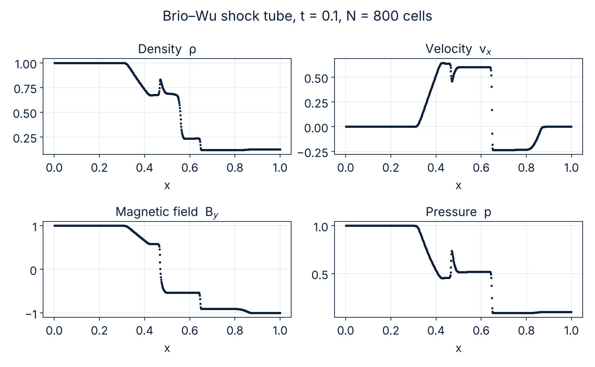
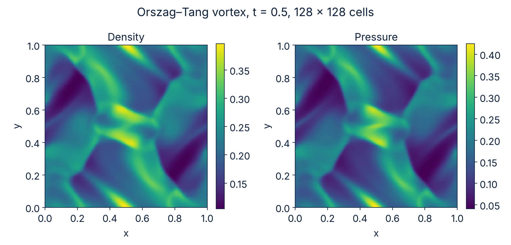
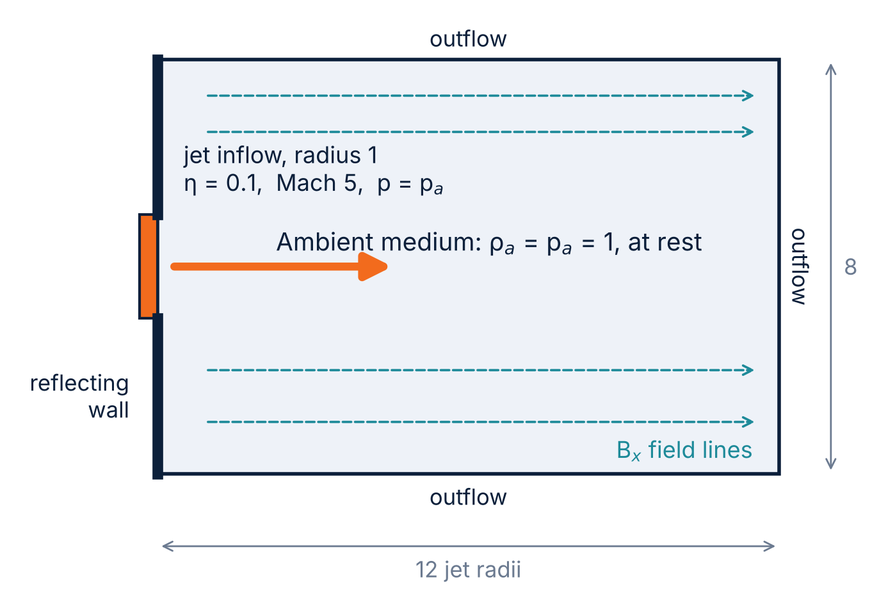
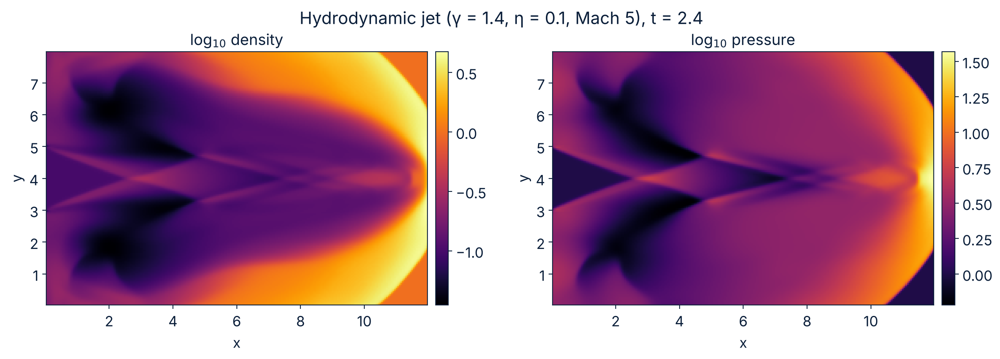
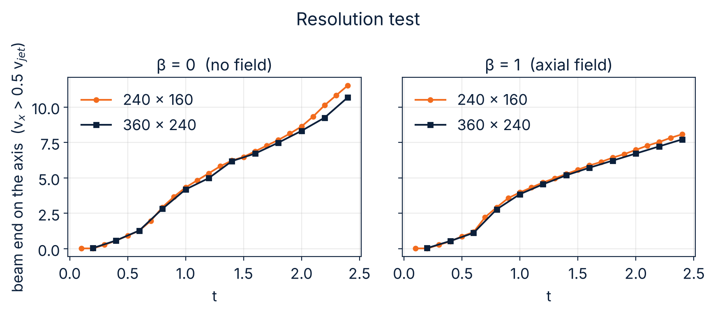
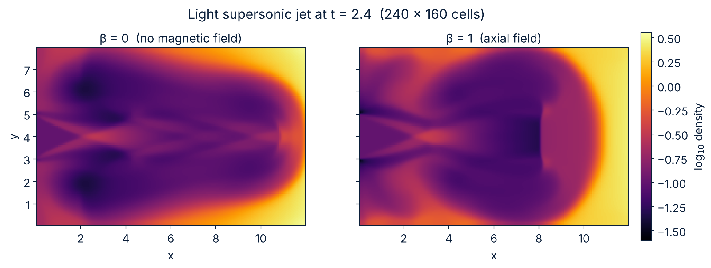
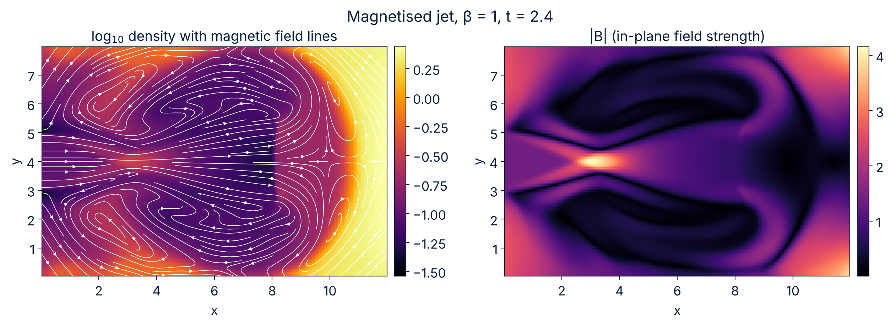

# mhd-jet: a small shock-capturing code, from Sod's tube to magnetised jets

A compact Fortran code that grows step by step from a 1D hydrodynamics solver to a 2D **ideal, non-relativistic MHD** solver with divergence cleaning, used to simulate a light supersonic jet with and without an axial magnetic field. The numerical method is the same throughout: a conservative high-resolution shock-capturing (HRSC) scheme in primitive variables.

> **Scope.** Classical (non-relativistic) ideal MHD, 2D Cartesian slab, γ = 5/3 for the MHD runs (γ = 1.4 for the hydrodynamic jet). This is a learning / exploratory project, not a production code.

## Numerical method

- Finite-volume, conservative update with second-order Runge-Kutta (Heun).
- Piecewise-linear TVD reconstruction of primitive variables with the **minmod** limiter.
- **LLF (Rusanov)** approximate Riemann solver, with the maximum signal speed |v_n| + c (hydro) or |v_n| + c_fast (MHD).
- 2D: unsplit, fluxes in x and y added in a single update, CFL condition Δt = C / (a_x/Δx + a_y/Δy).
- MHD: **GLM divergence cleaning** (Dedner et al. 2002). A ninth variable ψ carries divergence errors at speed c_h (the largest fast speed in the domain) and is damped by exp(-α c_h Δt / Δx_min), α = 0.1. Only the normal-B and ψ fluxes are modified (the energy equation is left unchanged).
- Floors on density and pressure in the jet runs.

## Contents

| Program | Physics | Test / purpose |
|---|---|---|
| `src/hydro.f90` | 1D Euler | Sod shock tube |
| `src/mhd.f90` | 1D MHD (B_x constant) | Brio-Wu shock tube |
| `src/hydro2d.f90` | 2D Euler | Sod tube along x and along y (symmetry check) |
| `src/jet2d.f90` | 2D Euler | light hydrodynamic jet (γ = 1.4) |
| `src/orszag.f90` | 2D MHD + GLM | Orszag-Tang vortex |
| `src/jetmhd.f90` | 2D MHD + GLM | magnetised jet, plasma beta given on the command line |

Modules: `hydro_solvers`, `mhd_solvers` (1D), `hydro2d_solvers`, `mhd2d_solvers` (2D).
Python scripts in `scripts/` read the text output and produce the figures.

## Build and run

Requirements: `gfortran`, Python 3 with NumPy and Matplotlib. On Windows (PowerShell):

```powershell
.\build.ps1          # compiles everything into .\run
cd run
.\orszag             # Orszag-Tang vortex, writes orszag.txt
python ..\scripts\orszag.py
.\jetmhd 0           # jet without magnetic field (control run)
.\jetmhd 1.0         # jet with plasma beta = 1
python ..\scripts\jetmhd.py 1.0
python ..\scripts\compare.py 0 1.0
```

The argument of `jetmhd` is the plasma beta β = 2p/B²; `0` means no magnetic field. Each run writes 24 snapshots (about 5 MB each at 240 × 160). Compilation flags: `-O2 -fdefault-real-8` (double precision).

## Validation

- **Sod (1D)**: N = 400, CFL = 0.9, compared with the exact Riemann solution (the exact-solution data come from course material and are not redistributed here).
- **Sod (2D)**: run along x and along y as a symmetry check of the y fluxes; the two profiles are expected to coincide.
- **Brio-Wu (1D MHD)**: N = 800, γ = 2, B_x = 0.75, t = 0.1. All the expected waves are present, including the compound wave.
  
- **Orszag-Tang (2D MHD)**: 128 × 128, γ = 5/3, t = 0.5. The density ranges over about 0.10-0.40 and the pressure over about 0.04-0.42; the usual pattern of interacting shocks is recovered (smoothed by LLF at this resolution).
  

## Jet setup

Slab jet entering from the left boundary of a box of size 12 × 8 (jet radius 1, injection around y = 4): density ratio η = ρ_jet/ρ_ambient = 0.1, Mach 5 with respect to the jet sound speed, jet in pressure equilibrium with the ambient medium (ρ_a = p_a = 1). Outflow conditions on the other boundaries, reflecting wall on the injection side outside the nozzle. In the MHD runs, a **uniform axial field** B_x = sqrt(2 p / β) fills the jet and the ambient medium (equal total pressure), so the field is divergence-free by construction and GLM only has to control numerical errors.



### Hydrodynamic jet (γ = 1.4, 240 × 160)

A bow shock, a cocoon and recollimation shocks along the beam form. The measured advance speed of the head on the axis is about 5.2-5.6 (three different criteria), compared with 4.49 from the 1D momentum-balance estimate v_j √η / (1 + √η). The 1D estimate is only an order-of-magnitude reference here.



### Magnetised jet (γ = 5/3), β = 0 vs β = 1, two resolutions

Compared in the same code (the β = 0 run is the control). Diagnostics on the axis, t = 2.4 unless stated.

| β | Grid | End of the supersonic beam (v_x > 0.5 v_jet) | Front of shocked ambient gas (ρ > 1.3), t = 2.0 | Cocoon width at x = 6 (ρ < 0.5) |
|---|---|---|---|---|
| 0 | 240 × 160 | 11.5 | 10.1 | 7.25 |
| 0 | 360 × 240 | 10.7 | 10.0 | 7.30 |
| 1 | 240 × 160 | 8.1 | 9.4 | 7.95 |
| 1 | 360 × 240 | 7.7 | 9.2 | 7.97 |





What can be said from these runs:

- With β = 1 the supersonic beam ends well upstream of where it ends without field (x ≈ 8 against 10.7-11.5), and this is reproduced at both resolutions.
- The overall advance of the head is only mildly affected (the shocked-gas front is 7-8 % behind at both resolutions).
- The cocoon width is stable with resolution to about 1 %.

## Limitations (please read before using the results)

- **Non-relativistic.** No Lorentz factor, no rest-mass energy; wave speeds are not bounded by c. It is not suited to relativistic (e.g. AGN) jets.
- **2D slab, not an axisymmetric jet.** There are no geometrical source terms and no 3D effects.
- **Diffusive scheme.** LLF with minmod is the most dissipative HRSC choice; in the MHD code the dissipation is set by the global GLM speed c_h. Consequently the β = 0 control run of the MHD code **does not exactly reproduce** the hydrodynamic jet code at the same γ: the beam positions agree to within roughly 5-10 % up to t ≈ 1.6 and diverge later. Compare magnetised runs with the MHD control, never with `jet2d`.
- **Diagnostics are proxies.** The beam end depends on where the terminal shock sits and it changes by about 7 % with resolution for β = 0. At t = 2.4 the bow shock of the control run reaches the right boundary of the box, so late-time values are biased.
- **Two resolutions only**, no convergence order estimated, and only β = 0 and β = 1 at both resolutions. Other values of β (0.3 and 10, at the low resolution only) gave a non-monotonic behaviour that is not understood and is not reported here as a result.
- Uniform axial field only; no toroidal or helical field.
- GLM with unmodified energy equation (not energy-consistent).

## Possible next steps

- A less diffusive solver (HLL, HLLD) and a higher-order reconstruction.
- Other field geometries (transverse or helical field), a wider range of β, higher resolutions.
- Axisymmetric (r, z) geometry.
- A relativistic version (primitive recovery, relativistic fast speed, relativistic Sod and Brio-Wu tests) in a separate branch.

## References

- Sod, G. A. 1978, J. Comput. Phys., 27, 1
- Brio, M. & Wu, C. C. 1988, J. Comput. Phys., 75, 400
- Orszag, S. A. & Tang, C.-M. 1979, J. Fluid Mech., 90, 129
- Dedner, A. et al. 2002, J. Comput. Phys., 175, 645
- Rusanov, V. V. 1961, J. Comput. Math. Math. Phys., 1, 267

## Acknowledgements

The HRSC formulation follows the lecture notes of the numerical-methods course at the University of Florence (not redistributed here).

## License

MIT, see `LICENSE`.
